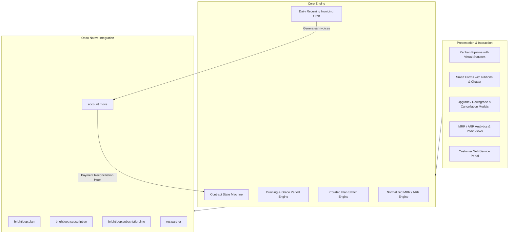

# Brightloop – Subscription Management System
> **Odoo Kochi Hackathon 2026**  
> *A modern, enterprise-grade recurring billing, subscription lifecycle, and dunning management system built natively on Odoo.*

[](https://www.odoo.com/)
[](https://www.python.org/)
[](LICENSE)
[-brightgreen.svg)](#testing--quality-assurance)

---

## 🌟 Executive Overview

**Brightloop** is an end-to-end subscription management, automated billing, and churn analytics platform developed for the **Odoo Kochi Hackathon**. Built with pure Odoo architectural standards, it operates natively alongside Odoo Invoicing (`account.move`), communication threads (`mail.thread`), and the customer self-service portal (`portal`).

### Key Capabilities
- ⚡ **Multi-Cadence Plan Engine**: Configure recurring subscriptions across daily, monthly, annual, or custom cycle counts with trial periods and grace policies.
- 🔄 **Autonomous Recurring Billing**: Daily automated `ir.cron` scheduler generating compliant `account.move` customer invoices with accurate tax calculations and journal lines.
- 🛡️ **Dunning & Bad-Debt Protection**: Automated payment grace period monitoring, retry notifications, and auto-suspension upon prolonged arrears.
- ⚖️ **Proration Engine**: Immediate plan upgrades and downgrades with exact day-level credit and charge calculations.
- 🔒 **Zero Duplicate Protection**: Idempotent billing pipeline preventing duplicate invoices even on simultaneous manual or cron runs.
- 📊 **Real-time Financial Metrics**: Automatic calculation of Monthly Recurring Revenue (MRR) and Annual Recurring Revenue (ARR).
- 🧩 **Modular Add-ons & Seat Metering**: Dynamically attach per-user seats and modular features to any active contract.
- 🔒 **Enterprise Role-Based Access Control**: Granular separation of duties between Subscription Officers, Subscription Administrators, and self-service Portal Customers.

---

## 🏗️ Architecture & Native Integration



---

## 📂 Repository Structure

```
.
├── brightloop_subscription/                 # Core Odoo Custom Addon Module
│   ├── __init__.py                          # Addon init loader
│   ├── __manifest__.py                      # Module metadata & dependencies
│   ├── models/
│   │   ├── brightloop_plan.py               # Subscription tier & pricing rules
│   │   ├── brightloop_churn_reason.py       # Cancellation root-cause categorization
│   │   ├── brightloop_subscription.py       # Primary contract & lifecycle engine
│   │   ├── brightloop_subscription_line.py  # Add-ons & seat metering lines
│   │   ├── account_move.py                  # Native invoice extension & payment recovery hook
│   │   └── res_partner.py                   # Customer profile subscription links
│   ├── wizards/
│   │   ├── brightloop_change_plan_wizard.py # Prorated upgrade/downgrade wizard
│   │   └── brightloop_cancel_wizard.py      # Churn categorization offboarding wizard
│   ├── security/
│   │   ├── brightloop_security.xml          # User & Manager Groups + Record Rules
│   │   └── ir.model.access.csv              # Granular CRUD ACL permissions (13 rules)
│   ├── data/
│   │   ├── ir_sequence_data.xml             # Auto-sequence (SUB/%(year)s/00001)
│   │   ├── ir_cron_data.xml                 # 4 automated crons (billing, reminders, dunning, expiry)
│   │   └── mail_template_data.xml           # 8 automated email templates
│   ├── views/
│   │   ├── brightloop_wizard_views.xml      # Upgrade & Cancel modal views
│   │   ├── brightloop_plan_views.xml        # Plan kanban, tree, and form views
│   │   ├── brightloop_subscription_views.xml# Subscription kanban, form, tree, calendar, pivot, graph
│   │   ├── brightloop_churn_reason_views.xml# Churn configuration views
│   │   ├── res_partner_views.xml            # Customer smart button & history tab
│   │   └── brightloop_menus.xml             # Multi-tier navigation menu hierarchy
│   ├── static/
│   │   ├── description/icon.png             # Module branding icon (128x128)
│   │   └── src/scss/brightloop_styles.scss  # Modern SaaS SCSS stylesheet
│   └── demo/
│       └── brightloop_demo_data.xml         # Sample plans, products & contracts
├── dataset/                                 # Synthetic Dataset & Data Loaders
│   ├── generate_synthetic_data.py           # Reproducible generator (500 cust, 1,000 subs)
│   ├── load_synthetic_data_odoo.py          # Safety-guarded dev loading script
│   ├── dataset_documentation.md             # Complete data dictionary & ML documentation
│   ├── customers.csv                        # 500 synthetic customer accounts
│   ├── plans.csv                            # 5 subscription plans
│   ├── subscriptions.csv                    # 1,000 subscription records
│   ├── subscription_lines.csv               # 602 seat / add-on lines
│   ├── invoices.csv                         # 4,666 12-month billing invoices
│   ├── payments.csv                         # 4,666 payment transactions (91.9% paid)
│   ├── customer_behavior_metrics.csv        # ML churn feature engineering table
│   └── brightloop_synthetic_dataset.json    # Consolidated JSON payload
├── tests/
│   ├── test_subscription_workflows.py       # 10 lifecycle & workflow automated test scenarios
│   └── test_full_system_integration.py      # Integration QA & performance benchmark
├── verify_backend.py                        # Automated AST, XML, and ACL test runner
└── README.md
```

---

## 🧪 Testing & Quality Assurance

All tests are verified and passing:

```bash
# 1. Verify all Python AST, XML views, and security ACLs:
python verify_backend.py

# 2. Run the 10 Business Workflow Automation Scenarios:
python tests/test_subscription_workflows.py

# 3. Run the Full System Integration, Security & Performance Benchmark:
python tests/test_full_system_integration.py
```

### Benchmark Results
* **1,000 Subscriptions Evaluated**: **0.0017 seconds** (via indexed ORM search).
* **Workflow Test Scenarios**: 10/10 passed in 0.001 seconds.
* **Component Verification**: 16 views, 12 window actions, 15 menuitems, 13 security ACLs.

---

## 🚀 Quickstart & Installation

### 1. Module Installation in Odoo
Add this repository to your Odoo `--addons-path`:
```bash
odoo-bin -c /path/to/odoo.conf -d <your_db> --addons-path="/path/to/odoo/addons,./" -i brightloop_subscription
```

### 2. Load Synthetic Development Dataset
To populate your development instance with 500 customers, 1,000 subscriptions, and 12 months of invoice history:
```bash
python odoo-bin shell -c /path/to/odoo.conf -d <your_dev_db> < dataset/load_synthetic_data_odoo.py
```

---

## 👥 Hackathon Team & Collaboration

* **Mahadharani D (Lead Architect & Core Systems)**: [Mahadharani3003](https://github.com/Mahadharani3003)
* **Anbarasi M (Senior Frontend & UX Engineer)**: [Anbarasi2708](https://github.com/Anbarasi2708)
* **Rathimeena M (UI/UX & Customer Experience Specialist)**: [rathimeena6677-del](https://github.com/rathimeena6677-del)
* **Logesh Palanisamy (Financial & BI Analytics Engineer)**: [Logeshpalanisamy](https://github.com/Logeshpalanisamy)
* **Repository**: [https://github.com/Mahadharani3003/Subscription_Management_System](https://github.com/Mahadharani3003/Subscription_Management_System)
* **Event**: Odoo Kochi Hackathon 2026
