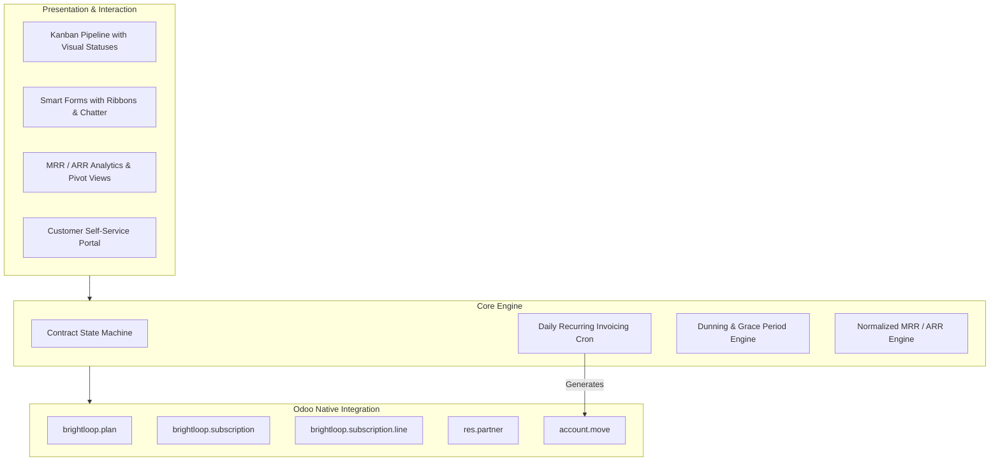

# Brightloop – Subscription Management System
> **Odoo Kochi Hackathon 2026**  
> *A modern, enterprise-grade recurring billing, subscription lifecycle, and dunning management system built natively on Odoo.*

[](https://www.odoo.com/)
[](https://www.python.org/)
[](LICENSE)
[](#testing--verification)

---

## 🌟 Executive Overview

**Brightloop** is designed from the ground up for modern SaaS platforms, subscription commerce, and recurring service businesses. It bridges the gap between flexible customer lifecycle management and robust ERP financial operations by directly leveraging Odoo's native framework (`base`, `account`, `mail`, `portal`).

### Key Capabilities
- ⚡ **Multi-Cadence Plan Engine**: Configure recurring subscriptions across daily, monthly, annual, or custom cycle counts with trial periods and grace policies.
- 🔄 **Autonomous Recurring Billing**: Daily automated `ir.cron` scheduler generating compliant `account.move` customer invoices with accurate tax calculations and journal lines.
- 🛡️ **Dunning & Bad-Debt Protection**: Automated payment grace period monitoring, retry notifications, and auto-suspension upon prolonged arrears.
- 📊 **Real-time Financial Metrics**: Automatic calculation of Monthly Recurring Revenue (MRR) and Annual Recurring Revenue (ARR).
- 🧩 **Modular Add-ons & Seat Metering**: Dynamically attach per-user seats and modular features to any active contract.
- 🔒 **Enterprise Role-Based Access Control**: Granular separation of duties between Subscription Officers, Subscription Administrators, and self-service Portal Customers.

---

## 🏗️ Architecture & Native Integration



---

## 📂 Repository Layout

```
.
├── brightloop_subscription/                 # Core Odoo Custom Addon Module
│   ├── __init__.py                          # Addon init loader
│   ├── __manifest__.py                      # Module metadata & dependencies
│   ├── models/
│   │   ├── brightloop_plan.py               # Subscription tier & pricing rules
│   │   ├── brightloop_churn_reason.py       # Cancellation root-cause categorization
│   │   ├── brightloop_subscription.py       # Primary contract & lifecycle engine
│   │   ├── brightloop_subscription_line.py  # Add-ons & seat metering lines
│   │   └── res_partner.py                   # Customer profile subscription links
│   ├── security/
│   │   ├── brightloop_security.xml          # User & Manager Groups + Record Rules
│   │   └── ir.model.access.csv              # Granular CRUD ACL permissions (11 rules)
│   ├── data/
│   │   ├── ir_sequence_data.xml             # Auto-sequence (SUB/%(year)s/00001)
│   │   ├── ir_cron_data.xml                 # Daily recurring billing & dunning crons
│   │   └── mail_template_data.xml           # Customer notification email templates
│   └── demo/
│       └── brightloop_demo_data.xml         # Sample plans, products & contracts
├── dataset/                                 # Synthetic Dataset & Data Loaders
│   ├── generate_synthetic_data.py           # Reproducible generator (500 cust, 1,000 subs)
│   ├── load_synthetic_data_odoo.py          # Safety-guarded dev loading script
│   ├── dataset_documentation.md             # Complete data dictionary & ML documentation
│   ├── customers.csv                        # 500 synthetic customer accounts
│   ├── plans.csv                            # 5 subscription plans
│   ├── subscriptions.csv                    # 1,000 subscription records
│   ├── subscription_lines.csv               # 602 seat / add-on lines
│   ├── invoices.csv                         # 4,666 12-month billing invoices
│   ├── payments.csv                         # 4,666 payment transactions (91.9% paid)
│   ├── customer_behavior_metrics.csv        # ML churn feature engineering table
│   └── brightloop_synthetic_dataset.json    # Consolidated JSON payload
├── verify_backend.py                        # Automated AST, XML, and ACL test runner
└── README.md
```

---

## 🚀 Quickstart & Installation

### 1. Module Installation in Odoo
Add this repository to your Odoo `--addons-path`:
```bash
odoo-bin -c /path/to/odoo.conf -d <your_db> --addons-path="/path/to/odoo/addons,./" -i brightloop_subscription
```

### 2. Testing & Verification
Verify that all Python AST structures, XML definitions, and security CSV permissions are 100% compliant:
```bash
python verify_backend.py
```

### 3. Load Synthetic Development Dataset
To populate your development instance with 500 customers, 1,000 subscriptions, and 12 months of invoice history:
```bash
python odoo-bin shell -c /path/to/odoo.conf -d <your_dev_db> < dataset/load_synthetic_data_odoo.py
```

---

## 👥 Hackathon Team & Collaboration

* **Lead Architect & Developer**: [Mahadharani3003](https://github.com/Mahadharani3003)
* **Repository**: [https://github.com/Mahadharani3003/Subscription_Management_System](https://github.com/Mahadharani3003/Subscription_Management_System)
* **Event**: Odoo Kochi Hackathon 2026
