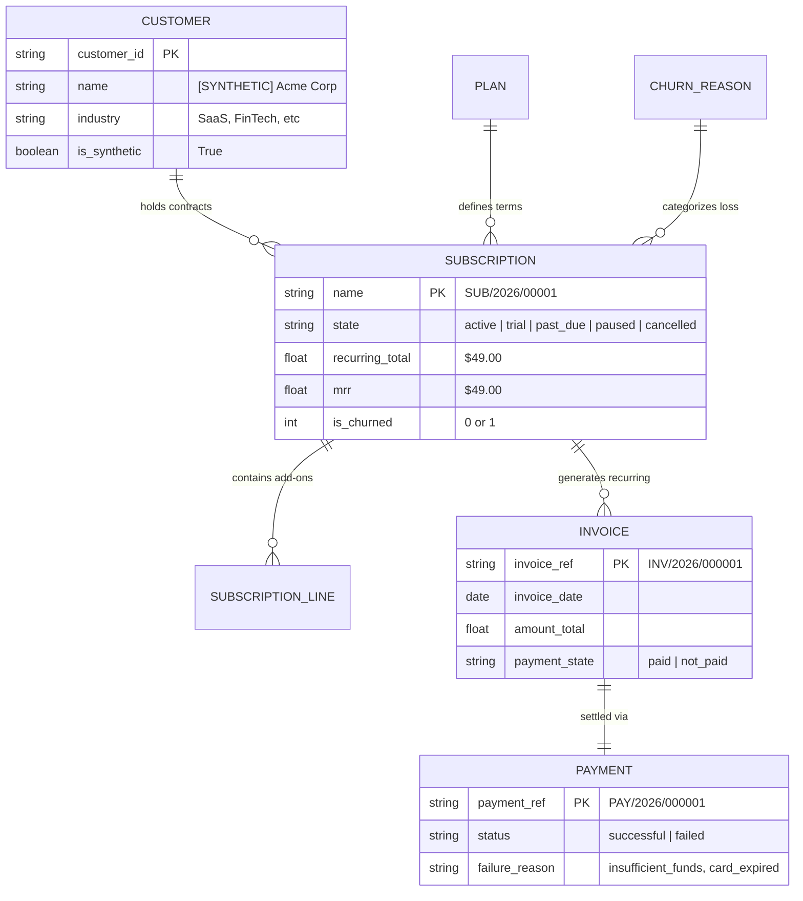

# Brightloop Synthetic Development & Testing Dataset
## Technical Specification, Data Dictionary & ML Pipeline Reference

---

> [!CAUTION]
> **SYNTHETIC DATA DISCLAIMER (REQUIREMENT 10)**  
> All records, transactions, payment behaviors, and churn labels contained in this dataset are **100% synthetically generated** for software testing, dashboard validation, and ML pipeline experimentation.  
> **Under no circumstances should accuracy, precision, or recall metrics achieved on this synthetic dataset be claimed or represented as real-world production performance.** Real customer churn dynamics are governed by non-linear external market forces not fully mirrored by synthetic distributions.

---

## 1. Dataset Overview & File Index

| File | Records | Primary Key / Index | Description |
|---|---|---|---|
| [`customers.csv`](file:///C:/Users/mahad/.gemini/antigravity-ide/scratch/brightloop/dataset/customers.csv) | 500 | `customer_id` | Business customers with synthetic flags, contacts, industries, and cities. |
| [`plans.csv`](file:///C:/Users/mahad/.gemini/antigravity-ide/scratch/brightloop/dataset/plans.csv) | 5 | `id` | Subscription tiers with pricing, intervals, trial, and grace periods. |
| [`subscriptions.csv`](file:///C:/Users/mahad/.gemini/antigravity-ide/scratch/brightloop/dataset/subscriptions.csv) | 1,000 | `name` | Complete subscription contracts across 5 operational states. |
| [`subscription_lines.csv`](file:///C:/Users/mahad/.gemini/antigravity-ide/scratch/brightloop/dataset/subscription_lines.csv) | 602 | `subscription_ref` | Modular seat and add-on line items. |
| [`invoices.csv`](file:///C:/Users/mahad/.gemini/antigravity-ide/scratch/brightloop/dataset/invoices.csv) | 4,666 | `invoice_ref` | 12-month billing history linked to Odoo `account.move` structure. |
| [`payments.csv`](file:///C:/Users/mahad/.gemini/antigravity-ide/scratch/brightloop/dataset/payments.csv) | 4,666 | `payment_ref` | Real-time payment transactions (4,286 paid, 380 failed). |
| [`customer_behavior_metrics.csv`](file:///C:/Users/mahad/.gemini/antigravity-ide/scratch/brightloop/dataset/customer_behavior_metrics.csv) | 500 | `customer_id` | ML feature engineering table for churn prediction experimentation. |
| [`brightloop_synthetic_dataset.json`](file:///C:/Users/mahad/.gemini/antigravity-ide/scratch/brightloop/dataset/brightloop_synthetic_dataset.json) | Unified | Root Object | Consolidated JSON schema for Odoo batch loaders. |

---

## 2. Relational Architecture & Entity Dependencies



---

## 3. Subscription Distribution & Churn Methodology

### 3.1 Lifecycle States Distribution (1,000 Subscriptions)
* **Active (`active`)**: 532 records (53.2%) — In progress, recurring smoothly.
* **Cancelled (`cancelled`)**: 253 records (25.3%) — Discontinued with explicit churn labels and reasons.
* **In Arrears (`past_due`)**: 86 records (8.6%) — Unpaid invoices within grace threshold.
* **Free Trial (`trial`)**: 84 records (8.4%) — Evaluating product before initial billing.
* **Paused (`paused`)**: 45 records (4.5%) — Temporarily suspended.

### 3.2 Defined Historical Churn Categories
1. **`BUDGET` (30%)**: Downsizing or macroeconomic cost reductions.
2. **`COMPETITOR` (28%)**: Migrated to external alternative vendor.
3. **`FEATURES` (18%)**: Missing specific product workflow requirements.
4. **`PAYMENT_FAILURE` (14%)**: Involuntary churn (repeated failed debits & expired cards).
5. **`PROJECT_DONE` (10%)**: Project completed or engagement wrapped up.

---

## 4. ML Feature Table: `customer_behavior_metrics.csv`

Specifically pre-engineered for predictive modeling and churn benchmark pipelines:

| Feature Name | Type | Description |
|---|---|---|
| `customer_id` | String | Unique identifier (`CUST-SYNTH-XXXX`) |
| `tenure_days` | Integer | Account age in days since signup |
| `subscription_count` | Integer | Cumulative subscriptions held |
| `active_subscription_count` | Integer | Currently active subscriptions |
| `total_invoices` | Integer | Total billing cycles encountered |
| `total_invoices_paid` | Integer | Successful payments count |
| `total_invoices_failed` | Integer | Declined or failed billing attempts |
| `payment_failure_rate` | Float | Ratio (`failed / total_invoices`) |
| `total_revenue_paid` | Float | Cumulative monetary value contributed ($) |
| `upgrades_count` | Integer | Tier advancement events |
| `downgrades_count` | Integer | Tier reduction events |
| `support_tickets_count` | Integer | Volume of support inquiries logged |
| `avg_platform_logins_monthly`| Float | Monthly platform engagement intensity |
| `is_churned` | Binary (0/1)| Target label: 1 if customer terminated all contracts |
| `churn_reason` | String | Ground-truth root cause classification |

---

## 5. Strict Production Guard & Isolation Rules (Requirements 7, 8, 9)

1. **Tagging Convention**: Every record is prefixed with `[SYNTHETIC]` or flagged `is_synthetic = True`.
2. **Production Block**: [`load_synthetic_data_odoo.py`](file:///C:/Users/mahad/.gemini/antigravity-ide/scratch/brightloop/dataset/load_synthetic_data_odoo.py) checks `env.cr.dbname` and aborts if it contains `prod`, `production`, or `live`.
3. **Purge Routine**:
   To completely wipe all synthetic records without touching live data:
   ```python
   # Inside Odoo shell
   from dataset.load_synthetic_data_odoo import wipe_synthetic_data
   wipe_synthetic_data(env)
   ```

---

## 6. Reproducibility Instructions

The entire dataset is strictly deterministic:
```bash
python dataset/generate_synthetic_data.py
```
* **Random Seed**: `42`
* **Anchor Date**: `2026-10-31`
* **Execution Time**: ~0.8 seconds (pure Python standard library).
