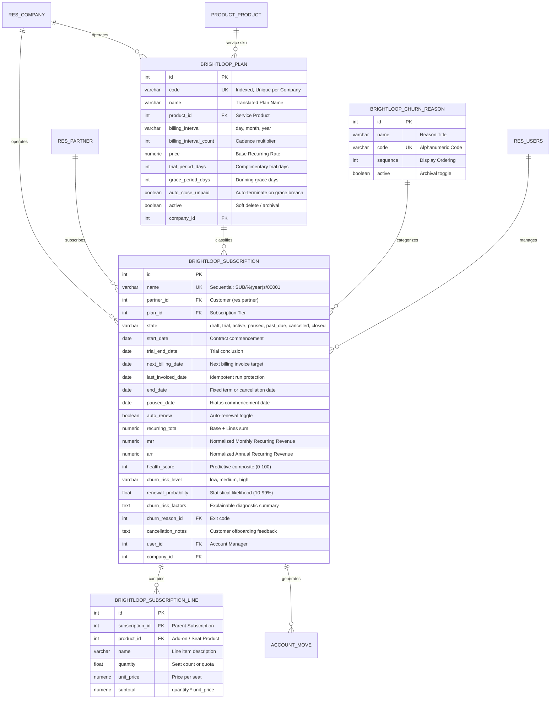

# Brightloop – Database Design & Entity-Relationship Specification
## Schema Architecture, Relational Mappings, Constraints, and Indexing Strategy
**Odoo Kochi Hackathon 2026**

---

### Table of Contents
1. [Entity-Relationship Diagram](#1-entity-relationship-diagram)
2. [Data Dictionary & Field Specifications](#2-data-dictionary--field-specifications)
3. [Relational Integrity & Foreign Key Actions](#3-relational-integrity--foreign-key-actions)
4. [Constraint Matrix (SQL & Business Validation)](#4-constraint-matrix-sql--business-validation)
5. [Indexing & Query Optimization Strategy](#5-indexing--query-optimization-strategy)

---

### 1. Entity-Relationship Diagram

---

### 2. Data Dictionary & Field Specifications

#### A. Table: `brightloop_plan`
- **Primary Key**: `id` (`integer`, auto-increment sequence).
- **Unique Constraint**: `unique(code, company_id)`.
- **Foreign Keys**:
  - `product_id` $\rightarrow$ `product_product.id` (`ON DELETE RESTRICT`).
  - `company_id` $\rightarrow$ `res_company.id` (`ON DELETE CASCADE`).
- **Indexed Columns**: `code`, `product_id`, `company_id`.

#### B. Table: `brightloop_subscription`
- **Primary Key**: `id` (`integer`, auto-increment sequence).
- **Unique Constraint**: `unique(name, company_id)`.
- **Foreign Keys**:
  - `partner_id` $\rightarrow$ `res_partner.id` (`ON DELETE RESTRICT`).
  - `plan_id` $\rightarrow$ `brightloop_plan.id` (`ON DELETE RESTRICT`).
  - `churn_reason_id` $\rightarrow$ `brightloop_churn_reason.id` (`ON DELETE SET NULL`).
  - `user_id` $\rightarrow$ `res_users.id` (`ON DELETE SET NULL`).
  - `company_id` $\rightarrow$ `res_company.id` (`ON DELETE CASCADE`).
- **Indexed Columns**: `name`, `partner_id`, `plan_id`, `state`, `start_date`, `next_billing_date`, `last_invoiced_date`, `end_date`, `auto_renew`, `churn_risk_level`, `user_id`, `company_id`.

#### C. Table: `brightloop_subscription_line`
- **Primary Key**: `id` (`integer`, auto-increment sequence).
- **Foreign Keys**:
  - `subscription_id` $\rightarrow$ `brightloop_subscription.id` (`ON DELETE CASCADE`).
  - `product_id` $\rightarrow$ `product_product.id` (`ON DELETE RESTRICT`).
- **Indexed Columns**: `subscription_id`, `product_id`.

#### D. Table: `brightloop_churn_reason`
- **Primary Key**: `id` (`integer`, auto-increment sequence).
- **Unique Constraint**: `unique(code)`.
- **Indexed Columns**: `code`, `sequence`.

---

### 3. Relational Integrity & Foreign Key Actions

| Parent Entity | Child Entity | Relationship | Odoo ORM Field | Foreign Key Delete Behavior |
| :--- | :--- | :--- | :--- | :--- |
| `brightloop.subscription` | `brightloop.subscription.line` | 1-to-Many | `line_ids` | **CASCADE** (Deleting subscription cleans up its add-on lines). |
| `brightloop.subscription` | `account.move` | 1-to-Many | `invoice_ids` | **SET NULL** (Invoices must remain intact for tax/audit compliance). |
| `brightloop.plan` | `brightloop.subscription` | 1-to-Many | `subscription_ids` | **RESTRICT** (Cannot delete a plan tier with active subscribers). |
| `res.partner` | `brightloop.subscription` | 1-to-Many | `subscription_ids` | **RESTRICT** (Cannot delete a customer with subscription history). |
| `brightloop.churn.reason` | `brightloop.subscription` | Many-to-1 | `churn_reason_id` | **SET NULL** (Archiving a churn code preserves cancellation history). |

---

### 4. Constraint Matrix (SQL & Business Validation)

| Target Model | Constraint Type | Constraint Definition | Purpose |
| :--- | :--- | :--- | :--- |
| `brightloop.plan` | SQL Unique | `unique(code, company_id)` | Prevents duplicate tier codes within the same operating entity. |
| `brightloop.plan` | SQL Check | `CHECK(price >= 0)` | Disallows negative plan prices. |
| `brightloop.plan` | SQL Check | `CHECK(billing_interval_count > 0)` | Ensures billing cadence is at least 1 day/month/year. |
| `brightloop.plan` | SQL Check | `CHECK(trial_period_days >= 0)` | Disallows negative trial days. |
| `brightloop.plan` | SQL Check | `CHECK(grace_period_days >= 0)` | Disallows negative grace periods. |
| `brightloop.subscription` | SQL Unique | `unique(name, company_id)` | Guarantees reference sequence uniqueness (`SUB/%(year)s/00001`). |
| `brightloop.subscription` | Python `@api.constrains` | `_check_dates_consistency()` | Ensures `end_date >= start_date` if termination date is set. |
| `brightloop.subscription` | Python `unlink()` | `_check_unlink_state()` | Blocks deletion of contracts in `active`, `trial`, `paused`, or `past_due`. |
| `brightloop.churn.reason` | SQL Unique | `unique(code)` | Enforces unique alphanumeric reason identifiers. |

---

### 5. Indexing & Query Optimization Strategy

#### Targeted Query Use-Cases:
1. **Daily Billing Cron**:
   - Query: `WHERE state = 'active' AND next_billing_date <= CURRENT_DATE`
   - Indexes: Combined B-Tree indexes on `state` and `next_billing_date`.
2. **Dunning & Grace Period Monitor**:
   - Query: `WHERE state IN ('active', 'past_due')`
   - Optimization: Pre-filtered to subscriptions with posted unpaid invoices.
3. **Predictive Churn Watchlist**:
   - Query: `WHERE state = 'active' AND churn_risk_level IN ('high', 'medium') ORDER BY health_score ASC`
   - Indexes: Indexed `state`, `churn_risk_level`, and `health_score`.
4. **Customer Portal Dashboard**:
   - Query: `WHERE partner_id IN (CHILD_OF partner_id)`
   - Indexes: Indexed foreign key `partner_id`.
