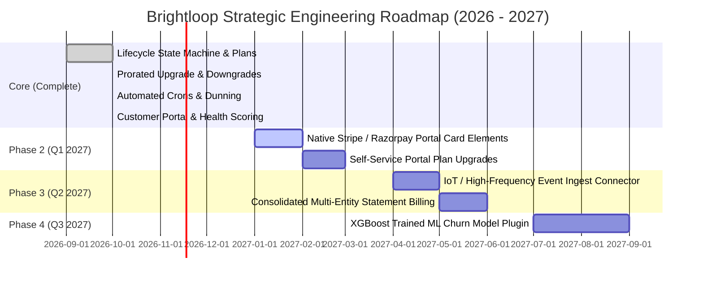

# Brightloop – Known Limitations & Future Product Roadmap
## Critical Technical Constraints, Trade-Offs, and Architecture Evolution
**Odoo Kochi Hackathon 2026**

---

### Executive Summary

In adherence to hackathon principles and enterprise engineering discipline, Brightloop prioritizes **functional reliability, explainability, security, and native Odoo compatibility** over brittle experimental integrations. This document formally outlines current technical boundaries, deliberate trade-offs, and our multi-phase production roadmap.

---

### 1. Known Architectural Limitations & Deliberate Trade-Offs

| Functional Domain | Current Brightloop State | Technical Constraint / Trade-Off | Production Recommendation |
| :--- | :--- | :--- | :--- |
| **Churn Risk Diagnostics** | Deterministic composite heuristic engine (0–100 score). | Operates offline on transactional and behavioral data (payments, tenure, auto-renew status). Lacks real-time product clickstream telemetry. | Connect an external product analytics webhook (Segment, PostHog, or Mixpanel) into `brightloop.subscription`. |
| **Payment Gateway Checkout** | Generates native Odoo `account.move` customer invoices; relies on Odoo's payment acquirers. | Does not bundle proprietary external Stripe/Razorpay JavaScript SDKs directly into the custom addon. | Leverage Odoo's standard payment acquirer tokens (`payment.provider`) for automated tokenized credit card charges. |
| **High-Volume Metering** | Add-on lines support seats, modules, and manual or cron-aggregated quantities. | Not designed to directly ingest 50,000 raw HTTP events/sec directly into PostgreSQL row-level lines. | Ingest raw telemetry into a time-series cache (ClickHouse or Redis) and batch-sync aggregate daily usage. |
| **Portal Plan Switching** | Customers can view all specs and Pause/Resume their active contract. | Full self-service mid-cycle upgrades via the portal currently redirect to sales/support rather than instant checkout. | Deploy the Phase 2 Portal Upgrade widget with embedded payment authorization. |
| **Multi-Entity Invoicing** | Supports multi-company with parent-child partner structures (`child_of`). | Parent enterprise paying for 100 decentralized subsidiary subscriptions is handled at the partner hierarchy level. | Add consolidated parent billing statement capabilities. |

---

### 2. Multi-Phase Future Roadmap

#### Phase 2 (Q1 2027): Enhanced Payment Automation & Portal Checkout
- Native Stripe Payment Elements embedded directly in `/my/subscriptions` for instant one-click card updates.
- Customer-initiated mid-cycle plan switches directly in the portal with instant charge capture.

#### Phase 3 (Q2 2027): High-Volume Usage Metering
- Microservice ingest endpoint buffering raw usage counters into Redis.
- Nightly aggregate cron compiling hourly/daily usage into `brightloop.subscription.line` items.

#### Phase 4 (Q3 2027): Predictive Machine Learning Integration
- Optional containerized Python sidecar running a pre-trained XGBoost or LightGBM model.
- Analyzes historical churn dataset (`dataset/customer_behavior_metrics.csv`) to surface predictive retention interventions.
