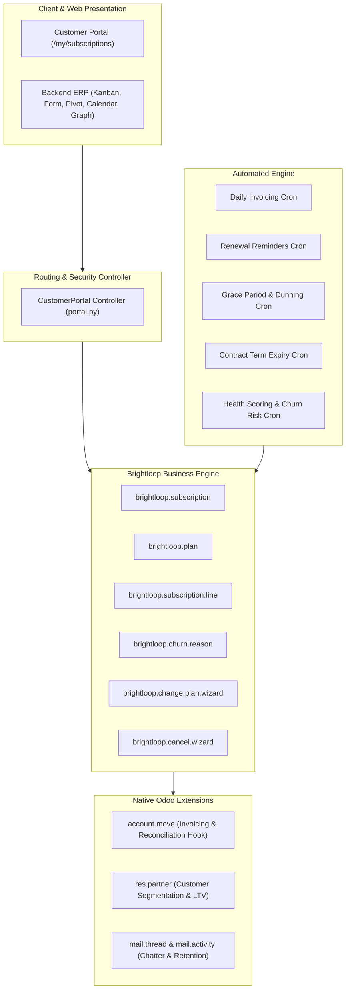
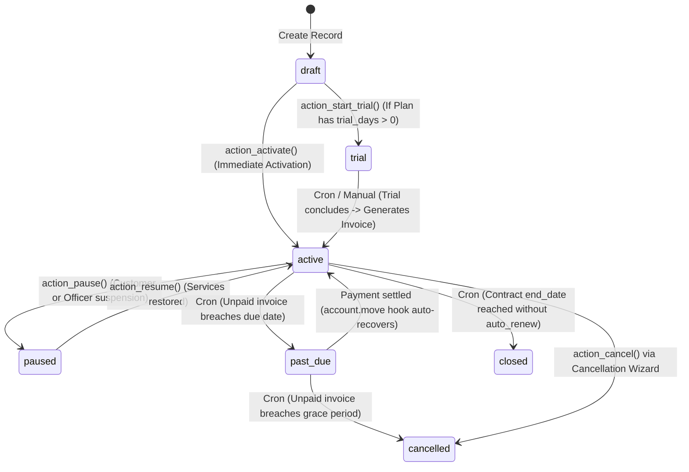

# Brightloop – Technical Architecture & Developer Reference Manual
## Comprehensive System Specifications, Data Schema, and Execution Workflows
**Odoo Kochi Hackathon 2026**

---

### Table of Contents
1. [System Architecture Overview](#1-system-architecture-overview)
2. [Module Architecture & Dependencies](#2-module-architecture--dependencies)
3. [Database Schema & Data Models](#3-database-schema--data-models)
4. [Business Workflows & State Machines](#4-business-workflows--state-machines)
5. [Security & Access Control Architecture](#5-security--access-control-architecture)
6. [Automated Schedulers & Background Crons](#6-automated-schedulers--background-crons)
7. [Email & Notification Infrastructure](#7-email--notification-infrastructure)
8. [Customer Self-Service Web Architecture](#8-customer-self-service-web-architecture)
9. [Developer Extension & Customization Guidelines](#9-developer-extension--customization-guidelines)

---

### 1. System Architecture Overview

Brightloop is built natively within the **Odoo 17.0** Object-Relational Mapping (ORM) framework, implementing standard Model-View-Controller (MVC) principles without modifying core files or introducing brittle third-party runtime dependencies.



---

### 2. Module Architecture & Dependencies

The module directory is structured strictly according to Odoo Community & Enterprise module guidelines:

```
brightloop_subscription/
├── __init__.py                          # Package root loader (models, wizards, controllers)
├── __manifest__.py                      # Module metadata, dependencies, assets & data loading order
├── controllers/
│   ├── __init__.py                      # Controller package init
│   └── portal.py                        # Customer self-service portal routing & action controllers
├── data/
│   ├── ir_sequence_data.xml             # Sequential reference generator (SUB/%(year)s/00001)
│   ├── ir_cron_data.xml                 # 5 automated background cron schedules
│   └── mail_template_data.xml           # 8 automated transactional mail templates
├── demo/
│   └── brightloop_demo_data.xml         # Sample tiers, demo accounts & subscriptions
├── models/
│   ├── __init__.py                      # Model package init
│   ├── account_move.py                  # Invoicing extension & payment state auto-recovery hook
│   ├── brightloop_churn_reason.py       # Exit feedback & churn classification model
│   ├── brightloop_plan.py               # Subscription plans, cadence, pricing & grace policy
│   ├── brightloop_subscription.py       # Core contract model, state machine, health score
│   ├── brightloop_subscription_line.py  # Add-ons, metered seats, and recurring line items
│   └── res_partner.py                   # Customer profile subscription links, LTV, segment
├── security/
│   ├── brightloop_security.xml          # Group definitions & multi-company/portal record rules
│   └── ir.model.access.csv              # 13 explicit Access Control List (ACL) rules
├── static/
│   ├── description/
│   │   └── icon.png                     # Standard 128x128 application branding icon
│   └── src/scss/
│       └── brightloop_styles.scss       # SaaS aesthetics, badges, ribbons & portal styling
├── views/
│   ├── brightloop_churn_reason_views.xml# Churn configuration views
│   ├── brightloop_menus.xml             # 17 menuitems and 14 window actions
│   ├── brightloop_plan_views.xml        # Plan Kanban cards, tree, and form views
│   ├── brightloop_subscription_portal_templates.xml # QWeb XML portal templates
│   ├── brightloop_subscription_views.xml# Kanban, Tree, Form, Calendar, Pivot, 2 Graphs, Search
│   ├── brightloop_wizard_views.xml      # Upgrade & Cancellation wizard dialogs
│   └── res_partner_views.xml            # Customer form smart button & subscriptions tab
└── wizards/
    ├── __init__.py                      # Wizard package init
    ├── brightloop_cancel_wizard.py      # Offboarding churn survey & cancellation handler
    └── brightloop_change_plan_wizard.py # Prorated mid-cycle tier switch calculator
```

#### Manifest Dependencies:
- `base`: Core Odoo framework and models (`res.company`, `res.users`, `res.partner`).
- `mail`: Chatter communication history, activity scheduling (`mail.activity`), and email templating.
- `account`: Native Odoo accounting engine (`account.move`, `account.move.line`, payment status tracking).
- `portal`: Web portal integration (`portal.portal_layout`, `portal_breadcrumbs`, customer access).

---

### 3. Database Schema & Data Models

#### A. `brightloop.plan` (Subscription Tiers)
| Field Name | Type | Constraints & Options | Description |
| :--- | :--- | :--- | :--- |
| `name` | Char | Required, Translate | Plan marketing name (e.g., Enterprise Annual). |
| `code` | Char | Required, Indexed, Unique/Company | Unique SKU identifier (e.g., `ENT-YR`). |
| `product_id` | Many2one | Required, `domain=[('type','=','service')]` | Native Odoo service product for invoice line mapping. |
| `billing_interval` | Selection | Required, Default `'month'` | Frequency: `day`, `month`, `year`. |
| `billing_interval_count`| Integer | Required, Default `1`, `CHECK > 0` | Cycle multiplier (e.g. 1 Month, 3 Months). |
| `price` | Monetary | Required, `CHECK >= 0` | Base recurring subscription price. |
| `trial_period_days` | Integer | Default `0`, `CHECK >= 0` | Complimentary trial days prior to initial invoice. |
| `grace_period_days` | Integer | Default `7`, `CHECK >= 0` | Arrears buffer before past-due suspension. |
| `auto_close_unpaid` | Boolean | Default `True` | Auto-cancel contract upon grace period expiration. |
| `active` | Boolean | Default `True` | Archival flag for deprecated tiers. |

#### B. `brightloop.subscription` (Primary Contract Model)
| Field Name | Type | Attributes | Description |
| :--- | :--- | :--- | :--- |
| `name` | Char | Required, Readonly, Indexed | Reference sequence (`SUB/%(year)s/00001`). |
| `partner_id` | Many2one | Required, Indexed, `res.partner` | Subscribing customer or corporate client. |
| `plan_id` | Many2one | Required, Indexed, `brightloop.plan`| Subscribed plan tier. |
| `state` | Selection | Required, Indexed, Tracking | `draft`, `trial`, `active`, `paused`, `past_due`, `cancelled`, `closed`. |
| `start_date` | Date | Required, Indexed, Default Today | Contract start date. |
| `trial_end_date` | Date | Optional, Tracking | Expiration date of complimentary trial. |
| `next_billing_date` | Date | Indexed, Tracking | Target date for next recurring invoice creation. |
| `last_invoiced_date`| Date | Readonly, Indexed, Copy=False | Idempotency safeguard preventing duplicate invoices. |
| `end_date` | Date | Indexed, Tracking | Fixed contract termination or cancellation date. |
| `paused_date` | Date | Readonly, Copy=False | Date contract was temporarily suspended. |
| `auto_renew` | Boolean | Default `True`, Indexed | Automatic renewal toggle. |
| `recurring_total` | Monetary | Computed, Stored | Sum of base plan price + active add-on seat lines. |
| `mrr` | Monetary | Computed, Stored | Monthly Recurring Revenue normalized to 30.4 days. |
| `arr` | Monetary | Computed, Stored | Annual Recurring Revenue normalized (`mrr * 12.0`). |
| `health_score` | Integer | Computed, Stored | Predictive score (0–100) representing account health. |
| `churn_risk_level` | Selection | Computed, Stored, Indexed | `low` ($\ge 75$), `medium` ($50–74$), `high` ($< 50$). |
| `renewal_probability`| Float | Computed, Stored | Calibrated statistical renewal likelihood ($10\%–99\%$). |
| `churn_risk_factors`| Text | Computed, Stored | Explainable human-readable diagnostic factors. |
| `churn_reason_id` | Many2one | `brightloop.churn.reason` | Formal reason code recorded upon cancellation. |

---

### 4. Business Workflows & State Machines

#### Contract Lifecycle Transitions:


#### Prorated Plan Switch Calculations:
When a customer upgrades or downgrades mid-cycle via [`brightloop.change.plan.wizard`](file:///C:/Users/mahad/.gemini/antigravity-ide/scratch/brightloop/brightloop_subscription/wizards/brightloop_change_plan_wizard.py):
$$\text{Remaining Ratio} = \frac{\text{Days Remaining in Current Cycle}}{\text{Total Days in Current Cycle}}$$
$$\text{Unused Credit (Old Plan)} = \text{Old Plan Price} \times \text{Remaining Ratio}$$
$$\text{Prorated Debit (New Plan)} = \text{New Plan Price} \times \text{Remaining Ratio}$$
$$\text{Net Adjustment} = \text{Prorated Debit} - \text{Unused Credit}$$

If $\text{Net Adjustment} > 0$, an immediate invoice is drafted for the customer. If $\text{Net Adjustment} < 0$, a credit memo is created. The contract is immediately updated to the new plan tier and recurring total.

---

### 5. Security & Access Control Architecture

The module enforces standard principle-of-least-privilege across 3 functional security personas:

1. **Subscription User / Officer (`group_brightloop_user`)**:
   - Full Read, Write, and Create permissions on Subscriptions, Add-on Lines, and Invoices.
   - Restricted from modifying base Plan configurations and Churn Reason taxonomy.
2. **Subscription Administrator (`group_brightloop_manager`)**:
   - Full Unrestricted Access (CRUD) across all models, wizards, configurations, and crons.
3. **Portal Subscriber (`base.group_portal`)**:
   - Read-only access to their own subscriptions via record rule `['partner_id', 'child_of', [user.partner_id.commercial_partner_id.id]]`.
   - Access to safe self-service action endpoints (Pause and Resume).

---

### 6. Automated Schedulers & Background Crons

Brightloop deploys 5 idempotent automated schedulers defined in [`ir_cron_data.xml`](file:///C:/Users/mahad/.gemini/antigravity-ide/scratch/brightloop/brightloop_subscription/data/ir_cron_data.xml):

| Cron ID | Execution Interval | Python Method Called | Idempotency & Safety Mechanism |
| :--- | :--- | :--- | :--- |
| `ir_cron_brightloop_recurring_billing` | Daily (1 day) | `_cron_recurring_billing()` | Checks `next_billing_date <= today` and verifies no invoice exists for the current date. Updates `last_invoiced_date`. |
| `ir_cron_brightloop_renewal_reminders` | Daily (1 day) | `_cron_renewal_reminders()` | Queries active auto-renewing subscriptions 3 days before `next_billing_date`. Prevents spam via `last_renewal_reminder_date`. |
| `ir_cron_brightloop_check_grace_periods` | Daily (1 day) | `_cron_check_grace_periods()` | Evaluates overdue posted invoices past `invoice_date_due`. Marks `past_due` and terminates on grace expiration. |
| `ir_cron_brightloop_check_expirations` | Daily (1 day) | `_cron_check_expirations()` | Closes fixed-term contracts reaching `end_date` with `auto_renew == False`. |
| `ir_cron_brightloop_recompute_health_scores` | Daily (1 day) | `_cron_recompute_health_scores()` | Recomputes health scores and auto-schedules high-risk retention activities (`mail.activity`) for Account Managers. |

---

### 7. Email & Notification Infrastructure

8 pre-configured Jinja-templated transactional email notifications in [`mail_template_data.xml`](file:///C:/Users/mahad/.gemini/antigravity-ide/scratch/brightloop/brightloop_subscription/data/mail_template_data.xml):
- `mail_template_subscription_welcome`: Triggered on contract activation.
- `mail_template_subscription_renewal_reminder`: 3-day advance notice before recurring charge.
- `mail_template_subscription_invoice_generated`: Dispatches generated billing invoices.
- `mail_template_subscription_payment_success`: Confirms receipt of subscription payment.
- `mail_template_subscription_payment_failure`: Alerts subscriber to payment decline.
- `mail_template_subscription_past_due_warning`: Urgent dunning notice citing grace period countdown.
- `mail_template_subscription_plan_changed`: Confirmation of prorated tier upgrade/downgrade.
- `mail_template_subscription_cancelled`: Offboarding exit confirmation.

---

### 8. Customer Self-Service Web Architecture

Subclasses Odoo's native `CustomerPortal`:
- **Route `/my/subscriptions`**: Paginated listing supporting server-side sorting (`order="next_billing_date asc"`) and status filtering (`all`, `active`, `trial`, `past_due`).
- **Route `/my/subscriptions/<int:sub_id>`**: Detailed contract view displaying plan attributes, seat lines, and posted invoice history.
- **Route `/my/subscriptions/<int:sub_id>/pause`**: POST endpoint verifying commercial partner identity before executing `sudo().action_pause()`.
- **Route `/my/subscriptions/<int:sub_id>/resume`**: POST endpoint verifying commercial partner identity before executing `sudo().action_resume()`.

---

### 9. Developer Extension & Customization Guidelines

#### Adding a Custom Metered Billing Source:
```python
# Inherit brightloop.subscription to add metered API usage lines
class CustomSubscriptionAPI(models.Model):
    _inherit = 'brightloop.subscription'

    api_call_count = fields.Integer(string='Monthly API Calls', default=0)

    def action_meter_and_invoice(self):
        self.ensure_one()
        # Add a metered line before billing cron triggers
        rate_per_thousand = 0.05
        metered_amount = (self.api_call_count / 1000.0) * rate_per_thousand
        # Append line item to subscription
        self.env['brightloop.subscription.line'].create({
            'subscription_id': self.id,
            'name': f"API Usage Overage ({self.api_call_count:,} calls)",
            'quantity': 1.0,
            'unit_price': metered_amount,
        })
        self.api_call_count = 0
```
